# ☁️ Playbook AWS — ToggleMaster (Tech Challenge Fase 1)

> Execução real em **20/10/2026**, região **us-east-1 (N. Virginia)**.
> Cada seção liga um requisito do enunciado ao que foi construído e à evidência que comprova.
> Os prints têm os dados sensíveis borrados (ID da conta, IP administrativo, endpoint do banco) e os pontos importantes marcados em vermelho.
> Antes de publicar, cada valor deste documento foi conferido na conta AWS (seção 10, "Auditoria").

## Sumário

| # | Etapa | Requisito do enunciado |
|---|---|---|
| 0 | [Visão geral e requisitos](#0-visão-geral-e-requisitos) | Todos |
| 1 | [Aplicação rodando localmente](#1-aplicação-rodando-localmente) | Cultura DevOps · vídeo: "aplicação rodando localmente" |
| 2 | [Ajustes no monolito para a nuvem](#2-ajustes-no-monolito-para-a-nuvem) | Análise da aplicação |
| 3 | [Arquitetura](#3-arquitetura) | Arquitetura Cloud · link do diagrama |
| 4 | [IAM com privilégio mínimo](#4-iam-com-privilégio-mínimo) | Práticas básicas de segurança (IAM) |
| 5 | [Rede: VPC, sub-redes e rotas](#5-rede-vpc-sub-redes-e-rotas) | VPC com sub-redes públicas e privadas |
| 6 | [Security Groups](#6-security-groups) | SG da EC2 e SG do RDS |
| 7 | [RDS PostgreSQL e EC2](#7-rds-postgresql-e-ec2) | RDS na privada · EC2 na pública |
| 8 | [Deploy e credenciais](#8-deploy-e-credenciais) | Conectar via SSH, instalar, configurar variáveis, executar |
| 9 | [Validação e testes de segurança](#9-validação-e-testes-de-segurança) | App acessível pelo IP público · SG funcionando |
| 10 | [Auditoria da conta](#10-auditoria-da-conta) | Conferência final |
| 11 | [Custos](#11-custos) | Estimativa na Calculadora de Preços |
| 12 | [Desafios e decisões](#12-desafios-e-decisões) | Relatório de entrega |
| 13 | [Limpeza](#13-limpeza) | — |

---

## 0. Visão geral e requisitos

**Objetivo da fase:** colocar a API monolítica ToggleMaster no ar na AWS, com a aplicação numa EC2 pública e o banco num RDS PostgreSQL privado, aplicando as práticas iniciais de segurança.

O enunciado e a aula de apresentação do desafio (03/09/2026) definem o que precisa ser entregue. A tabela abaixo é o mapa deste playbook.

| Requisito | Onde está | Situação |
|---|---|---|
| Executar a aplicação localmente para entender o funcionamento | Seção 1 | ✅ |
| Analisar o código e explicar por que é um monolito | Seção 2 e `docs/12-factor-checklist.md` | ✅ |
| Identificar o que atende ao 12-Factor e o que precisa de ajuste | `docs/12-factor-checklist.md` | ✅ |
| Diagrama com VPC, sub-redes pública e privada, EC2, RDS e Security Groups | Seção 3 | ✅ |
| Estimativa de custo mensal na Calculadora de Preços da AWS | Seção 11 | ✅ |
| Provisionar manualmente a infraestrutura no console | Seções 4 a 7 | ✅ |
| Conectar na EC2 via SSH e instalar dependências | Seção 8 | ✅ |
| Configurar a conexão com o RDS por variáveis de ambiente | Seção 8 | ✅ |
| Validar a aplicação pelo IP público da instância | Seção 9 | ✅ |
| Mostrar os Security Groups e como as credenciais foram gerenciadas (vídeo) | Seções 6 e 8 | ✅ |

**Pontos que o professor destacou em aula:**

- usar o repositório base `dougls/toggle-master-monolith` e os endpoints do README;
- a aplicação lê `DB_HOST`, `DB_NAME`, `DB_USER` e `DB_PASSWORD` do ambiente;
- validar a aplicação acessível pelo IP ou DNS público da EC2;
- no vídeo, mostrar os Security Groups e a gestão das credenciais;
- usar a Calculadora de Preços da AWS para a estimativa;
- discutir os 12 Fatores com base no material da disciplina (`josenetoo/fiap-demo-12-factor-app`).

---

## 1. Aplicação rodando localmente

**Enunciado:** "Execute a aplicação monolítica localmente para entender seu funcionamento."

**O que foi feito:** o `docker compose up --build` sobe dois contêineres. O `db` é um PostgreSQL 13. A `app` roda o `entrypoint.sh`, que espera o banco, cria a tabela `flags` e inicia o Gunicorn na porta 5000.

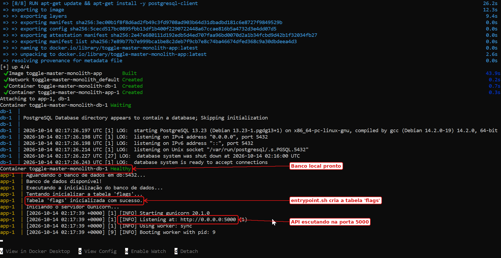

**Testes dos 5 endpoints**, no PowerShell do Windows. No PowerShell, `curl` é um apelido de outro comando; por isso os testes usam `Invoke-RestMethod`.

```powershell
Invoke-RestMethod http://localhost:5000/health
Invoke-RestMethod -Method Post -Uri http://localhost:5000/flags -ContentType "application/json" -Body '{"name": "new-feature", "is_enabled": true}'
Invoke-RestMethod http://localhost:5000/flags
Invoke-RestMethod -Method Put -Uri http://localhost:5000/flags/new-feature -ContentType "application/json" -Body '{"is_enabled": false}'
Invoke-RestMethod http://localhost:5000/flags/new-feature
```

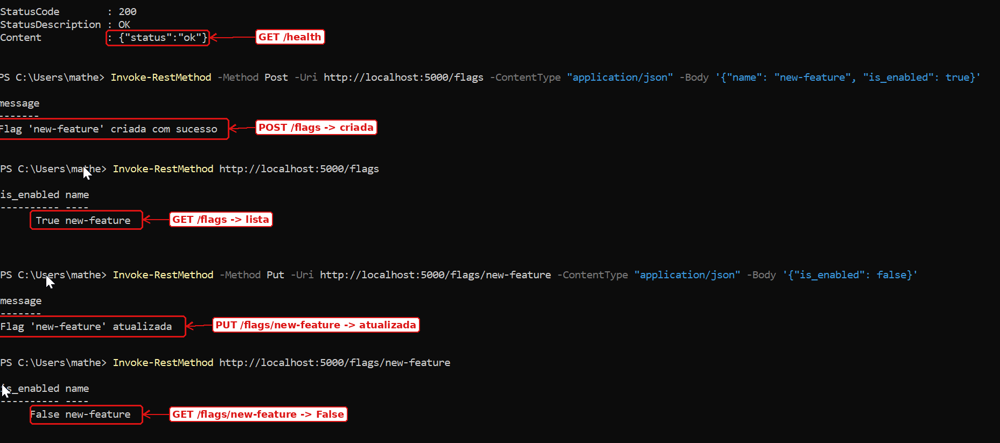

**Problema encontrado no Windows:** o Git converteu o `entrypoint.sh` para o padrão de quebra de linha do Windows (CRLF). O contêiner caiu com `./entrypoint.sh: 2: set: Illegal option -`. A correção foi converter o arquivo para LF e criar um `.gitattributes` com `*.sh text eol=lf`, para o erro não voltar.

---

## 2. Ajustes no monolito para a nuvem

**Enunciado:** "Analise o código e identifique por que ele é considerado um monolito."

**Por que é um monolito:** rotas HTTP, regras de negócio e acesso ao banco estão num único arquivo, `app.py`, empacotado e implantado como um único processo.

O código foi testado seguindo o guia da EC2 à risca, fora do Docker, antes de ir para a nuvem. Apareceram três problemas que impediriam o deploy:

| Problema | Sintoma | Correção |
|---|---|---|
| A tabela `flags` só era criada pelo `entrypoint.sh`, que só roda no Docker | Na EC2, `/health` respondia ok, mas `POST /flags` dava erro 500 (`relation "flags" does not exist`) | O `app.py` passou a chamar `init_db()` ao iniciar; `CREATE TABLE IF NOT EXISTS` é seguro de repetir |
| `psycopg2-binary 2.9.5` não instala em Python 3.12+ | `pip install` falha | Atualizado para 2.9.10 |
| `gunicorn 20.1.0` depende de `pkg_resources` | Não inicia em Python 3.12+ | Atualizado para 23.0.0 |

Também foram adicionados:

- leitura de `DB_PORT`, `DB_SSLMODE` e timeout de conexão de 5 s no `app.py`;
- `deploy/togglemaster.service`, para o systemd manter a API no ar;
- `deploy/togglemaster.env.example`, modelo do arquivo de credenciais;
- `.gitignore`, para impedir o versionamento de `venv` e `.env`.

As mudanças estão no fork [`duartecraft/toggle-master-monolith`](https://github.com/duartecraft/toggle-master-monolith), 2 commits à frente do repositório base:

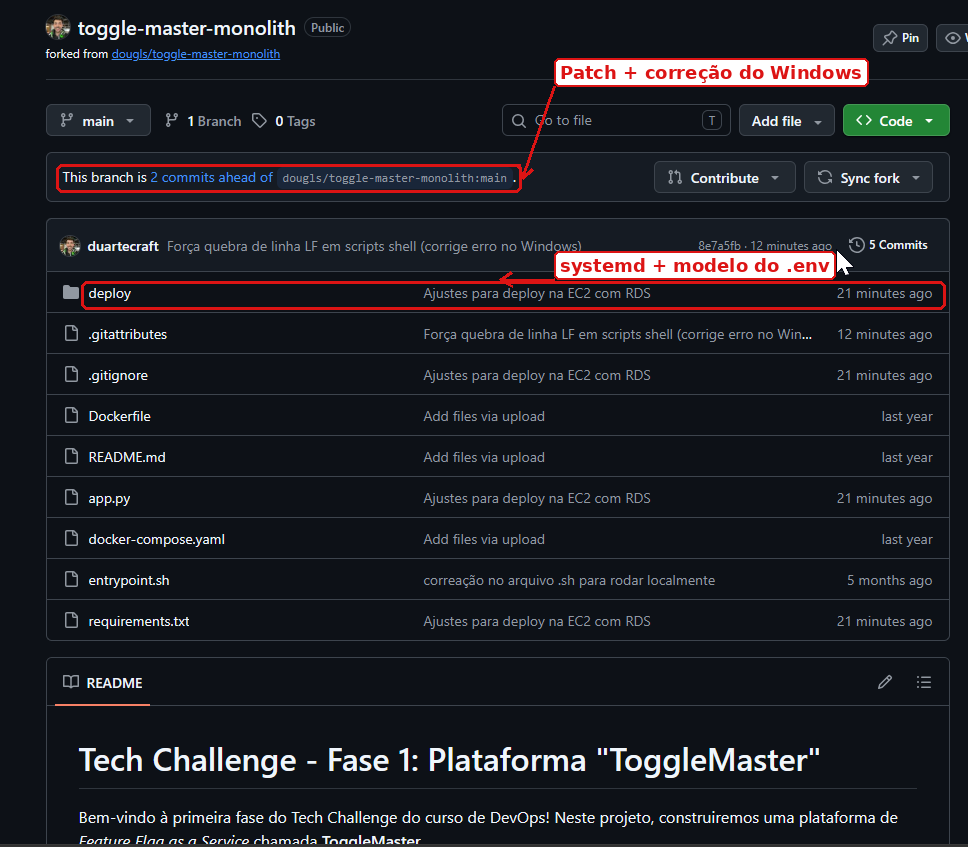

> Lição para a discussão de 12 Fatores (fator X, paridade entre ambientes): "funcionava no Docker" escondia um passo que só existia dentro do contêiner.

---

## 3. Arquitetura

**Enunciado:** "Desenhe um diagrama de arquitetura simples para hospedar a aplicação na AWS", com VPC, sub-redes públicas e privadas, EC2 na pública, RDS na privada e os dois Security Groups.

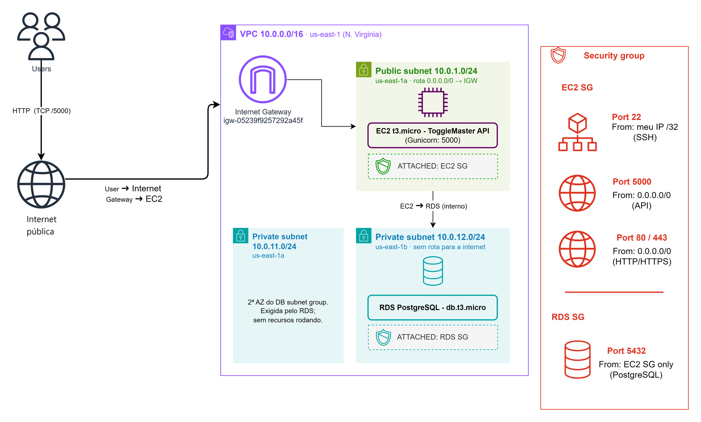

Arquivo editável: [`diagrams/togglemaster-arquitetura-aws.drawio`](../../diagrams/togglemaster-arquitetura-aws.drawio). Para abrir, use o diagrams.net em **Arquivo → Abrir de → Dispositivo**.

**Como uma requisição percorre a arquitetura:**

1. O usuário chama `http://IP_PUBLICO_DA_EC2:5000/flags`.
2. A requisição entra na VPC pelo Internet Gateway.
3. A tabela de rotas pública entrega o tráfego à EC2.
4. O `sg-app` confere a porta 5000 e libera.
5. O Gunicorn recebe, e o Flask consulta o banco.
6. A EC2 conecta no RDS pela rede interna da VPC, na porta 5432, com SSL.
7. O `sg-database` confere que a origem é o `sg-app` e libera.
8. A resposta volta pelo mesmo caminho.

**Decisões de arquitetura:**

| Decisão | Motivo |
|---|---|
| Região us-east-1 | Cerca de metade do preço de São Paulo; a latência não importa para o MVP |
| Rede em duas zonas **diferentes** (us-east-1a e us-east-1b) | Exigência do RDS: o DB subnet group precisa de sub-redes em pelo menos duas zonas diferentes. Por isso há uma sub-rede privada em cada zona |
| Banco Single-AZ | Não contradiz a linha anterior: o subnet group diz **onde o banco pode rodar** (duas zonas); o Single-AZ diz que **uma única instância** roda, numa zona só (a AWS escolheu a us-east-1b). Multi-AZ dobraria o custo e não é exigido nesta fase |
| Sem NAT Gateway | Custa cerca de US$ 32/mês e o banco não precisa sair para a internet |
| Sem Load Balancer | A API é acessada direto pelo IP da EC2; ALB com HTTPS fica para as próximas fases |

---

## 4. IAM com privilégio mínimo

**Objetivo da fase:** "Compreender e aplicar práticas básicas de segurança na AWS (IAM, Security Groups)."

**O que foi feito:** nada foi criado com o usuário root. O root foi usado só para criar o usuário `deploy-projeto`, que tem **MFA** e a política própria `projeto-ec2-rds`.

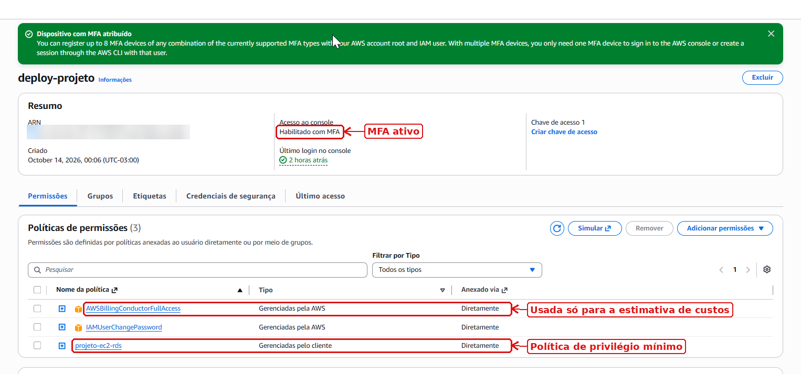

A política libera somente o necessário:

| Bloco | Libera | Restrição |
|---|---|---|
| `EC2eVPCnaRegiao` | EC2 e VPC | Só em us-east-1 (`aws:RequestedRegion`) |
| `RDSnaRegiao` | RDS | Só em us-east-1 |
| `RoleDoRDS` | Criar uma única role de IAM | Só a role interna do RDS |
| `ConsoleLeitura` | Leitura de identidade e métricas | Leitura |
| `LoginDoConectorMCP` | Login do conector de automação usado no projeto | — |
| `OrcamentoEAlerta` / `LerPrecos` | Orçamento, alerta e calculadora de preços | Sem acesso ao faturamento |
| `ValidacaoPeloConsole` | CloudShell e Reachability Analyzer | Usados na seção 9 |

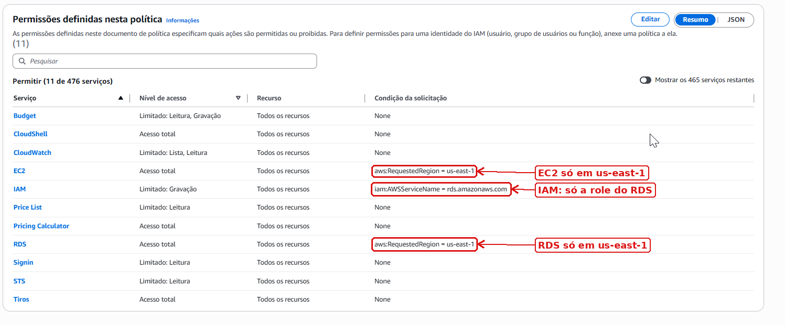

Tudo que não está na lista fica bloqueado: criar usuários, usar outras regiões, acessar S3 ou ver o faturamento. A tela de faturamento comprova isso:

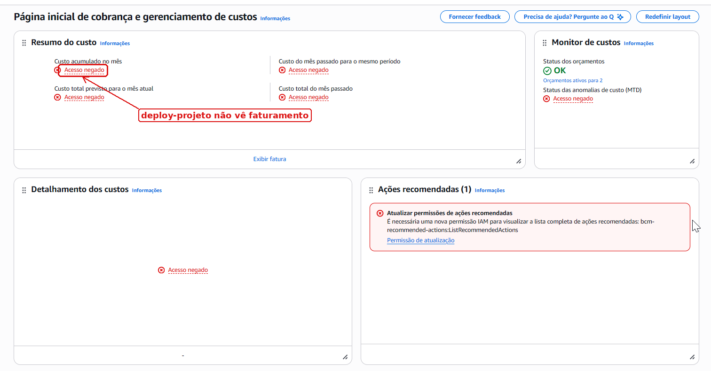

> **Sobre a política `AWSBillingConductorFullAccess`** (marcada no print acima): ela foi anexada ao `deploy-projeto` apenas durante a geração da estimativa de custos. Não é necessária para operar a infraestrutura, e a própria estimativa já é coberta pela política do projeto (bloco `OrcamentoEAlerta`, ação `bcm-pricing-calculator:*`).
>
> Neste projeto, o `deploy-projeto` é operado por quem também administra a conta. Por isso a exposição dessa permissão a mais é controlada. Ainda assim, o privilégio mínimo deve seguir a **granularidade de quem acessa cada parte**: quem opera EC2, VPC e RDS não precisa de permissões de faturamento. Se o usuário for compartilhado com outra pessoa do grupo, a política deve ser removida em **IAM → Users → deploy-projeto → Remover**, e tarefas de custo devem ficar com o administrador da conta.

---

## 5. Rede: VPC, sub-redes e rotas

**Enunciado:** "Uma VPC com sub-redes públicas e privadas."

**O que foi feito:** VPC `togglemaster-vpc` com 4 sub-redes em duas zonas.

| Sub-rede | CIDR | Zona | Tipo | Rota para a internet | Uso |
|---|---|---|---|---|---|
| public1 | `10.0.1.0/24` | us-east-1a | Pública | `0.0.0.0/0 → igw-05239f9257292a45f` | **EC2** |
| public2 | `10.0.2.0/24` | us-east-1b | Pública | `0.0.0.0/0 → igw-05239f9257292a45f` | Reserva (vazia) |
| private1 | `10.0.11.0/24` | us-east-1a | Privada | Nenhuma | 2ª zona do DB subnet group |
| private2 | `10.0.12.0/24` | us-east-1b | Privada | Nenhuma | **RDS** |

- **VPC:** `vpc-048fd030a1b1aec17`, `10.0.0.0/16`, com DNS hostnames ligado, para a EC2 achar o RDS pelo nome.
- **O que torna uma sub-rede pública:** a rota `0.0.0.0/0` apontando para o Internet Gateway.
- **Sub-redes privadas:** só têm a rota `local`, que alcança o resto da VPC e nada além dela.

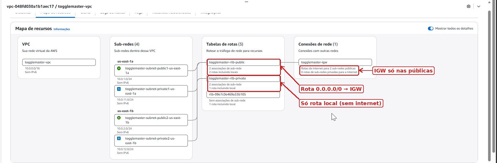

A terceira tabela de rotas do mapa, `rtb-09e7c0e469a33b105`, é a tabela principal que a AWS cria em toda VPC. Ela não está associada a nenhuma sub-rede.

---

## 6. Security Groups

**Enunciado:**
- "Um Security Group para a EC2 permitindo tráfego HTTP/HTTPS e SSH (de um IP específico)."
- "Um Security Group para o RDS permitindo tráfego apenas do Security Group da EC2."

**Guia do professor:** liberar 5000 (aplicação) e 22 (SSH) na EC2, e 5432 vinda do SG da EC2 no RDS.

| Security Group | Porta | Origem | Para quê |
|---|---|---|---|
| `sg-app` (`sg-0c2290d18dafa70d9`) | 22 | **IP do administrador /32** | SSH só de um IP específico |
| `sg-app` | 5000 | `0.0.0.0/0` | API do ToggleMaster |
| `sg-app` | 80 | `0.0.0.0/0` | HTTP, exigido pelo enunciado |
| `sg-app` | 443 | `0.0.0.0/0` | HTTPS, exigido pelo enunciado |
| `sg-database` (`sg-019d0b5e68bae8728`) | 5432 | **`sg-app`** | Só a EC2 chega no banco |

Valores conferidos na conta em 20/10/2026 (seção 10).

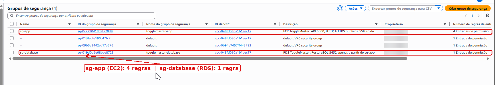

**Por que a regra do banco aponta para um SG e não para um IP:** se a EC2 trocar de IP, a regra continua valendo. E qualquer máquina sem o `sg-app` é recusada, mesmo dentro da VPC.

**Detalhe encontrado:** a AWS não aceita nomes de Security Group que comecem com `sg-`. Por isso o nome técnico ficou `togglemaster-app` e `togglemaster-database`, e o **Name** exibido no console ficou `sg-app` e `sg-database`.

Sobre o HTTPS: a porta 443 está liberada, como pede o enunciado, mas a aplicação responde em HTTP na porta 5000. Em produção, o HTTPS viria de um Application Load Balancer com certificado do AWS Certificate Manager.

---

## 7. RDS PostgreSQL e EC2

**Enunciado:**
- "Um RDS (PostgreSQL ou MySQL) na sub-rede privada para o banco de dados."
- "Uma instância EC2 na sub-rede pública para rodar a aplicação."

| Recurso | Configuração | Motivo |
|---|---|---|
| **RDS** `togglemaster-db` | PostgreSQL 18.3, `db.t3.micro`, 20 GB gp2, Single-AZ | Menor classe adequada ao MVP |
| | **Public access: No** | O banco não recebe IP público |
| | DB subnet group com as 2 sub-redes privadas | Exigência do RDS |
| | Initial database name `togglemaster` | A aplicação espera esse banco |
| | Criptografia em repouso, backup de 1 dia, `rds.force_ssl = 1` | Boas práticas sem custo extra |
| **EC2** `togglemaster-app` | Amazon Linux 2023, `t3.micro`, sub-rede public1 | Sistema exigido pelo guia (opção A) |
| | IP público automático, `sg-app`, chave SSH própria | Acesso pela internet e por SSH |
| | Disco de 8 GB gp3 criptografado, IMDSv2 obrigatório | Protege o disco e os metadados da instância |

As interfaces de rede confirmam onde cada servidor está:

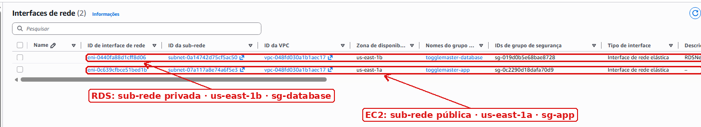

| Servidor | IP privado | IP público | Zona |
|---|---|---|---|
| EC2 | `10.0.1.69` | `98.92.111.146` | us-east-1a |
| RDS | `10.0.12.54` | **nenhum** | us-east-1b |

EC2 e RDS ficaram em zonas diferentes, porque a AWS escolheu a zona do banco ao criá-lo. Isso não afeta o funcionamento. O tráfego entre zonas custa cerca de US$ 0,01 por GB, o que dá centavos neste projeto.

---

## 8. Deploy e credenciais

**Enunciado:** "Conecte-se à instância EC2 via SSH", "instale as dependências da aplicação" e "configure a aplicação para se conectar ao banco de dados RDS (usando variáveis de ambiente para as credenciais)."

**Vídeo:** "Mostre as configurações de Security Group e como as credenciais do banco foram gerenciadas."

### 8.1 Instalação

No primeiro boot, um script de user data executou o equivalente à **opção A** do guia (Amazon Linux):

```bash
dnf update -y
dnf install -y git python3 python3-pip
dnf install -y postgresql17 || dnf install -y postgresql16 || dnf install -y postgresql15   # cliente psql para testes
git clone https://github.com/duartecraft/toggle-master-monolith.git
python3 -m venv venv && ./venv/bin/pip install -r requirements.txt
cp deploy/togglemaster.service /etc/systemd/system/
cp deploy/togglemaster.env.example /etc/togglemaster.env && chmod 600 /etc/togglemaster.env
```

O script **não contém senha**. O user data fica visível no console e dentro da máquina, então colocar a senha ali seria guardá-la em texto aberto.

### 8.2 Credenciais do banco

1. A senha do RDS foi gerada aleatoriamente, com 24 caracteres.
2. O arquivo de variáveis foi enviado por `scp`, pelo canal SSH criptografado.
3. Na EC2, o arquivo foi instalado com dono `root` e permissão `600`, e a cópia temporária foi apagada:

```bash
sudo install -m 600 -o root -g root /tmp/togglemaster.env /etc/togglemaster.env
rm /tmp/togglemaster.env
sudo ls -l /etc/togglemaster.env      # -rw-------. 1 root root
```

O arquivo segue o modelo `deploy/togglemaster.env.example`:

```bash
DB_HOST=<endpoint-do-rds>
DB_PORT=5432
DB_NAME=togglemaster
DB_USER=postgres
DB_PASSWORD=<senha>
DB_SSLMODE=require
```

| Onde a senha **não** está | Por quê |
|---|---|
| Código e Git | O `.gitignore` bloqueia `.env`, e o repositório só tem o modelo |
| Script de user data | Ficaria visível no console da EC2 |
| Histórico do terminal | Nenhum `export` com a senha foi digitado |
| Arquivo legível por outros usuários | `chmod 600` com dono root |

O systemd lê o arquivo ao iniciar o serviço (`EnvironmentFile=/etc/togglemaster.env`) e entrega as variáveis à aplicação. É o fator III dos 12 Fatores: configuração no ambiente, fora do código.

### 8.3 Execução

O guia permite rodar o Gunicorn em primeiro plano. Aqui foi usado o **systemd**, como o próprio guia recomenda para produção. Assim a API continua no ar depois que o SSH é fechado e volta sozinha se a máquina reiniciar.

```bash
psql "host=<endpoint> dbname=togglemaster user=postgres sslmode=require" -c "select version();"   # PostgreSQL 18.3
sudo systemctl enable --now togglemaster
sudo journalctl -u togglemaster -n 20 --no-pager
```

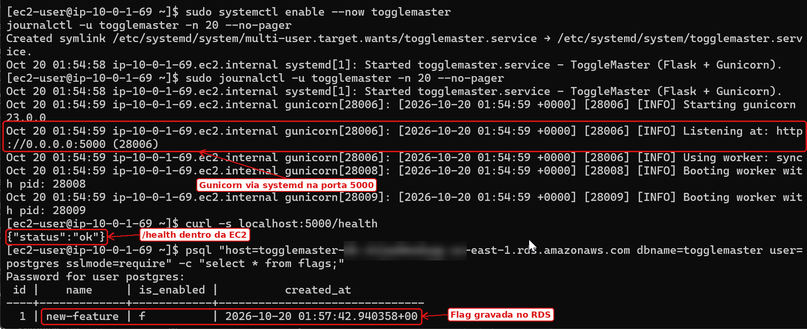

---

## 9. Validação e testes de segurança

**Enunciado:** "Execute a aplicação na EC2 e valide que ela está acessível publicamente através do IP ou DNS da instância."

Cada regra de segurança foi testada nos dois sentidos: **o que deve passar, passa; o que deve ser barrado, é barrado.**

### 9.1 API pública e persistência no RDS

Do PC do administrador, pela internet:

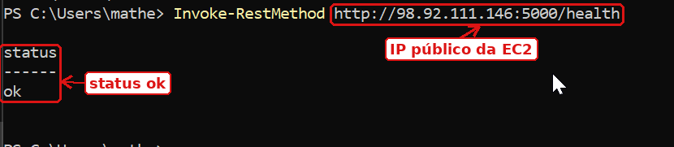

O `POST` e o `PUT` feitos do PC gravaram no RDS: `new-feature`, `is_enabled = f`, criada em 20/10/2026 às 01:57 UTC (print da seção 8.3).

### 9.2 SSH de outro IP é bloqueado

Conectado pela rede celular (4G), com outro IP, o SSH expirou. Na mesma rede, a API pela porta 5000 continuou respondendo.

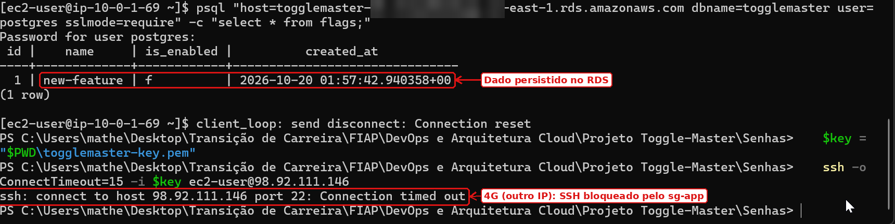

### 9.3 Testes de dentro da AWS (CloudShell)

O CloudShell roda fora da VPC e com IP diferente do administrador (`44.210.96.179`), por isso serve de "usuário qualquer da internet".

| Teste | Resultado | O que prova |
|---|---|---|
| `curl http://98.92.111.146:5000/health` | `{"status":"ok"}` | API pública |
| `curl .../flags` | `new-feature` com `false` | EC2 lê do RDS |
| Conexão na porta 22 da EC2 | **BLOQUEADO** | SSH só do IP do administrador |
| Conexão na porta 5432 do RDS | **BLOQUEADO** | Banco inacessível de fora |
| `getent hosts <endpoint do RDS>` | `10.0.12.54` | O endereço do banco é privado |

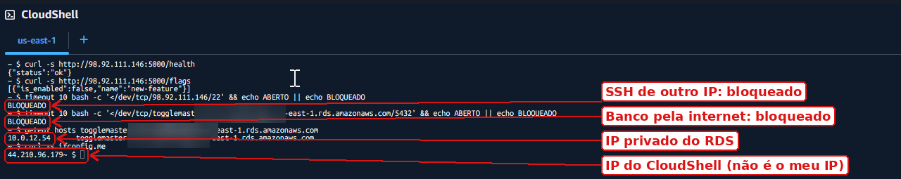

### 9.4 Caminhos de rede (VPC Reachability Analyzer)

O Reachability Analyzer analisa a configuração da rede e aponta qual componente libera ou bloqueia cada caminho:

| Caminho | Porta | Resultado | Explicação da AWS |
|---|---|---|---|
| `internet-para-api`: IGW → EC2 | 5000 | Acessível | Rota pública + `sg-app` liberam |
| `ssh-de-ip-estranho`: IGW (origem 8.8.8.8) → EC2 | 22 | **Não acessível** | `ENI_SG_RULES_MISMATCH`: o `sg-app` não aceita esse IP |
| `internet-para-banco`: IGW → RDS | 5432 | **Não acessível** | `IGW_PRIVATE_IP_ASSOCIATION_FOR_INGRESS` (só IP privado) + `ENI_SG_RULES_MISMATCH` (`sg-database`) |
| `ec2-para-banco`: EC2 → RDS | 5432 | Acessível | `sg-database` aceita a origem `sg-app` |

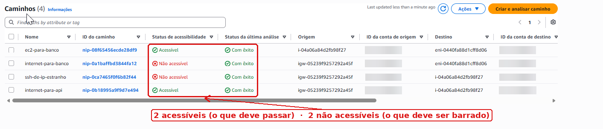

O caminho `internet-para-banco` mostra **duas camadas de proteção**: a rede, porque o banco não tem IP público, e o firewall, porque o `sg-database` recusa a origem. Mesmo que uma falhasse, a outra seguraria.

---

## 10. Auditoria da conta

Todos os valores deste playbook foram conferidos na conta, por API, em **20/10/2026 às 03:06 (UTC-3)**, e comparados com o diagrama:

| Item do diagrama | Valor na conta | Confere |
|---|---|---|
| VPC `10.0.0.0/16` · us-east-1 | `10.0.0.0/16`, DNS hostnames ligado | ✅ |
| Internet Gateway | `igw-05239f9257292a45f`, ligado à VPC | ✅ |
| Public subnet `10.0.1.0/24` · 1a · rota → IGW | Confere, com IP público automático | ✅ |
| Private subnet `10.0.12.0/24` · 1b · sem internet | Só rota `local` | ✅ |
| Private subnet `10.0.11.0/24` · 1a | Só rota `local`, no DB subnet group | ✅ |
| EC2 t3.micro na pública | Running, status checks ok/ok, só `sg-app` | ✅ |
| RDS PostgreSQL db.t3.micro na privada | 18.3, us-east-1b, sem IP público, porta 5432 | ✅ |
| EC2 SG: 22 do IP /32; 5000, 80 e 443 abertas | Exatamente essas 4 regras de entrada | ✅ |
| RDS SG: 5432 só do EC2 SG | Uma única regra, origem `sg-app` | ✅ |

Também foi conferido que **não há** NAT Gateway, Elastic IP solto, VPC endpoint ou snapshot manual gerando custo.

---

## 11. Custos

**Enunciado:** "Faça uma estimativa de custo mensal para essa arquitetura usando a Calculadora de Preços da AWS."

A arquitetura custa **US$ 27,41 por mês** ligada o tempo todo, com preço cheio de us-east-1 e sem descontos de Free Tier.

| Item | Uso mensal | US$/mês |
|---|---|---|
| RDS `db.t3.micro` PostgreSQL | 730 h | 13,14 |
| EC2 `t3.micro` Linux | 730 h | 7,59 |
| IPv4 público da EC2 | 730 h | 3,65 |
| RDS armazenamento gp2 | 20 GB | 2,30 |
| EBS gp3 da EC2 | 8 GB | 0,64 |
| Transferência para a internet | 1 GB | 0,09 |
| **Total** | | **27,41** |

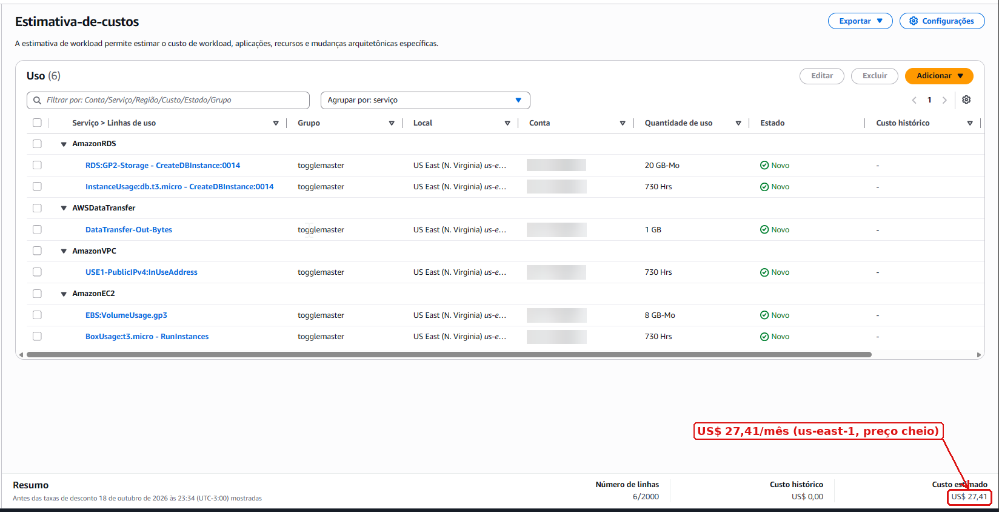

Para acompanhar o gasto real, foi criado o orçamento `togglemaster-mensal`, de US$ 30/mês. Ele envia e-mail ao passar de 80% do gasto real e de 100% da previsão.

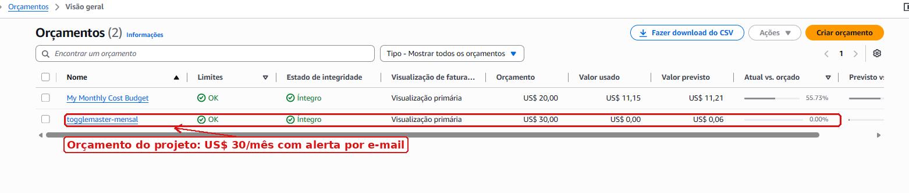

**Para gastar menos:** pare o RDS (**Actions → Stop temporarily**) e a EC2 quando não estiver usando. O IP público da EC2 muda ao religar.

---

## 12. Desafios e decisões

| Desafio | Decisão |
|---|---|
| Guia da EC2 não criava a tabela `flags` | A aplicação cria a tabela ao iniciar |
| Bibliotecas antigas falhavam em Python 3.12+ | `psycopg2-binary` 2.9.10 e `gunicorn` 23.0.0 |
| `entrypoint.sh` quebrava no Docker do Windows (CRLF) | Conversão para LF e `.gitattributes` |
| `git push` ia para o repositório do professor | Fork próprio, `origin` no fork e `upstream` no original |
| Nome `sg-app` recusado pela AWS | Nome técnico `togglemaster-app`, Name `sg-app` |
| Credenciais fora do código | `/etc/togglemaster.env` com `chmod 600`, lido pelo systemd |
| App parava ao fechar o SSH | Serviço systemd com `Restart=always` |
| Terminal do navegador (EC2 Instance Connect) falhava | Mantido só o SSH com chave, para o SG continuar restrito a um IP |
| Custo | Sem NAT, ALB nem Multi-AZ; us-east-1; orçamento com alerta |

---

## 13. Limpeza

Depois da entrega, apague nesta ordem, para evitar erros de dependência:

1. **RDS → togglemaster-db → Actions → Delete**, sem snapshot final e sem manter backups.
2. **EC2 → togglemaster-app → Instance state → Terminate**.
3. Quando o RDS sumir: **RDS → Subnet groups → togglemaster-db-subnets → Delete**.
4. **EC2 → Key Pairs → togglemaster-key → Delete**.
5. **VPC → togglemaster-vpc → Actions → Delete VPC**: apaga sub-redes, IGW, rotas e Security Groups.
6. **VPC Reachability Analyzer:** apague os 4 caminhos.
7. No dia seguinte, confira em **Billing → Bills** que nada continua cobrando.
